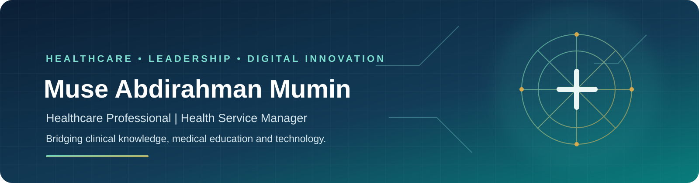
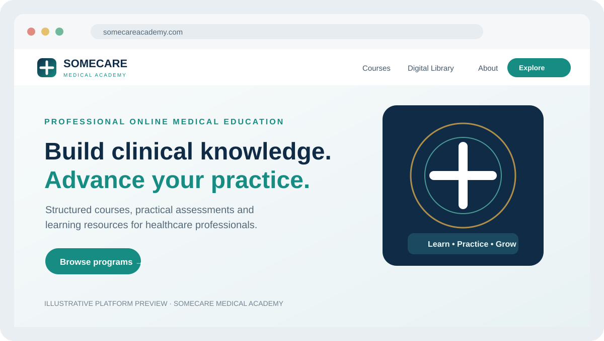

<!-- Professional GitHub profile README for @Mouse-Stars -->

  

<h1 align="center">Muse Abdirahman Mumin</h1>
<h3 align="center">Healthcare Professional · Health Service Manager · Medical Laboratory Scientist</h3>

  <strong>Connecting healthcare, medical education, management, and digital innovation.</strong>

  

  
  
  

---

## 👨‍⚕️ About Me

I am a healthcare professional with an academic background in **Medical Laboratory Science** and **Health Service Management**, with interests spanning clinical practice, medical education, healthcare quality, and digital health.

I serve as the **Director/Manager of Al Amana Specialist Hospital** in Burco, Somaliland. My professional interests focus on improving healthcare delivery through effective leadership, evidence-informed practice, quality improvement, and practical digital solutions.

I am also developing skills in technology and digital product development to help create useful tools for healthcare professionals and learners.

## 🎓 Education

- **BSc in Medical Laboratory Science** — University of Hargeisa (2019)
- **Master's-level studies in Health Service Management** — Abaarso Tech University
- **Medicine and Surgery** — Medical studies, Golis University

## 🧭 Professional Interests

- Hospital management, leadership, and healthcare administration
- Medical laboratory science and diagnostic services
- Clinical documentation and health information systems
- Healthcare quality improvement and patient safety
- Medical education, e-learning, and curriculum development
- Digital health and technology-enabled healthcare solutions

---

## 🚀 Featured Project

### Somecare Medical Academy

  

**Advancing Medical Knowledge. Empowering Healthcare Professionals.**

Somecare Medical Academy is an online medical education platform being developed in Somaliland for healthcare students and professionals. It aims to bring structured courses, practical assessments, and digital medical learning resources together in one accessible learning environment.

**Platform areas**
- **Online courses:** structured lessons, learning modules, quizzes, and assessments
- **Digital medical library:** eBooks, PDF study resources, presentations, and revision materials
- **Student portal:** learner accounts, course access, progress, results, and certificates
- **Academic development:** practical, evidence-informed learning for healthcare disciplines

**Flagship learning programme:** Clinical Documentation — an 8-week, 24-lesson course covering patient histories, physical examination records, SOAP notes, outpatient records, and inpatient documentation.

  
  
  

**Technology:** Next.js · TypeScript · Supabase · Vercel

**Source repository:** private development repository.

---

## 🛠️ Technology & Tools

  
  
  
  
  

I am continuously developing my skills in version control, web technologies, database-backed applications, and digital learning platforms through practical projects.

## 📌 Projects

| Project | Description | Links |
|---|---|---|
| **Somecare Medical Academy** | Online medical education platform, digital learning resources, and student learning environment | [Website](https://somecareacademy.com) · [Courses](https://somecareacademy.com/courses) |
| **GitHub Profile & Portfolio** | My professional profile, learning journey, and public project showcase | [Repository](https://github.com/Mouse-Stars/Mouse-Stars) |

*Project visuals and links will be expanded as additional public projects are published.*

---

## 📊 GitHub Statistics

  
  

  

---

## 🎯 Mission

To combine healthcare knowledge, management experience, medical education, and technology to support better healthcare services and empower the next generation of healthcare professionals.

## 📫 Connect With Me

- **Email:** [Muusa186@gmail.com](mailto:Muusa186@gmail.com)
- **WhatsApp:** [Chat with me](https://wa.me/252634373897)
- **Facebook:** [My Facebook profile](https://www.facebook.com/share/1E98MmjXX9/?mibextid=wwXIfr)
- **GitHub:** [@Mouse-Stars](https://github.com/Mouse-Stars)
- **Location:** Burco, Somaliland

---

  <em>“Better healthcare through knowledge, collaboration, and thoughtful innovation.”</em>

  Thank you for visiting my profile.

